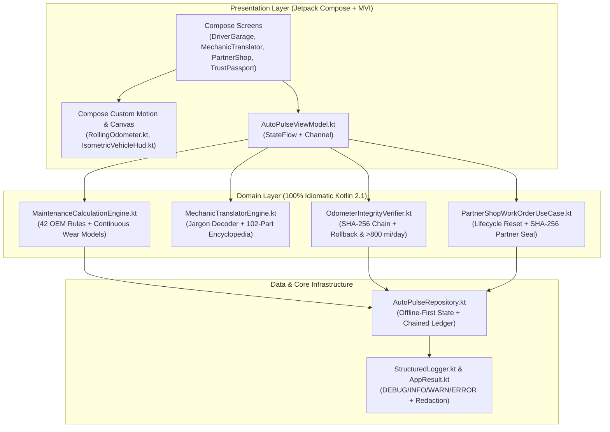

# AutoPulse Native Android Architecture (MAD Clean Architecture + MVI)

## 1. Layered Architecture Overview

AutoPulse strictly separates pure Kotlin domain/cryptographic business logic (`:core`) from the Jetpack Compose Material 3 presentation layer (`:app`), following Google's Modern Android Development (MAD) guidelines.

---

## 2. Module & File Reference (All Strictly $\le 500$ Lines)

| File Path | Layer | Responsibility |
| :--- | :--- | :--- |
| `core/.../core/version/AppVersion.kt` | Core | Semantic version (`1.3.0`) & platform metadata |
| `core/.../core/logging/StructuredLogger.kt` | Core | Structured logger with `DEBUG`, `INFO`, `WARN`, `ERROR` and automatic sensitive-key redaction |
| `core/.../core/result/AppResult.kt` | Core | `AppResult<T>` sealed interface, `AppError` hierarchy, and `runCatchingLogged` boundary wrapper |
| `core/.../domain/model/VehicleModels.kt` | Domain | Vehicle, rule, health status, and diagnostic report models |
| `core/.../domain/catalog/OemMaintenanceCatalog.kt` | Domain | 42 OEM maintenance rules across 6 categories with 3D hotspot coordinates |
| `core/.../domain/engine/MaintenanceCalculationEngine.kt` | Domain | Wear percentage math (`HEALTHY`, `DUE_SOON`, `OVERDUE`), brake/battery models, and VIN decoder |
| `core/.../domain/catalog/MechanicJargonCatalog.kt` | Domain | Curated mechanic jargon definitions and fair parts/labor ranges |
| `core/.../domain/catalog/CarPartsEncyclopediaCatalog.kt` | Domain | 102 essential automotive parts categorized across all 6 vehicle systems |
| `core/.../domain/engine/MechanicTranslatorEngine.kt` | Domain | Multimodal jargon decoder, quote fairness evaluator, and encyclopedia search |
| `core/.../domain/security/OdometerIntegrityVerifier.kt` | Domain | SHA-256 hash chaining, rollback detection ($\Delta M < 0$), velocity check ($R > 800\text{ mi/day}$), and Trust Score |
| `core/.../domain/usecase/PartnerShopWorkOrderUseCase.kt` | Domain | Digital work order execution, cycle reset, and SHA-256 Partner Service Seal signing |
| `core/.../data/repository/AutoPulseRepository.kt` | Data | Offline-first repository with pre-seeded vehicles and chained odometer ledgers |
| `core/.../presentation/viewmodel/AutoPulseViewModel.kt` | Presentation | MVI `StateFlow<AutoPulseUiState>` and `Channel<AutoPulseUiEffect>` orchestrator |
| `app/.../presentation/theme/AutoPulseTheme.kt` | UI (Compose) | Obsidian Cockpit Material 3 design tokens and color palette |
| `app/.../presentation/components/AdaptiveLayoutUtils.kt` | UI (Compose) | 250dp ultra-compact viewport responsive breakpoint engine |
| `app/.../presentation/components/RollingOdometer.kt` | UI (Compose) | Mechanical digit-by-digit vertical tumbler roll with responsive scaling |
| `app/.../presentation/components/IsometricVehicleHud.kt` | UI (Compose) | 360° 3D wireframe car Canvas HUD with dynamic projection and health rings |
| `app/.../presentation/screens/DriverGarageScreen.kt` | UI (Compose) | Action-first priority queue, category filters, and guided vehicle command center |
| `app/.../presentation/screens/MechanicTranslatorScreen.kt` | UI (Compose) | Repair copilot, preset quote chips, fairness meter, and interview checklist |
| `app/.../presentation/screens/PartnerShopTerminalScreen.kt` | UI (Compose) | 3-step technician intake terminal, service checklist, and SHA-256 seal generator |
| `app/.../presentation/screens/TrustPassportScreen.kt` | UI (Compose) | 0–100 Trust Score gauge, anti-fraud checklist, and visual ledger timeline |
